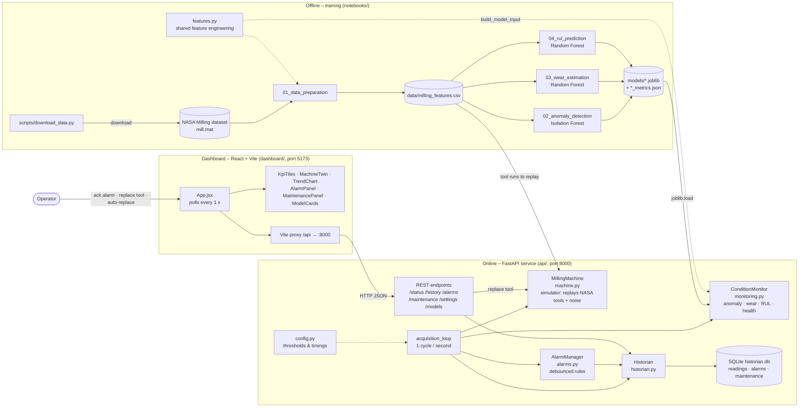
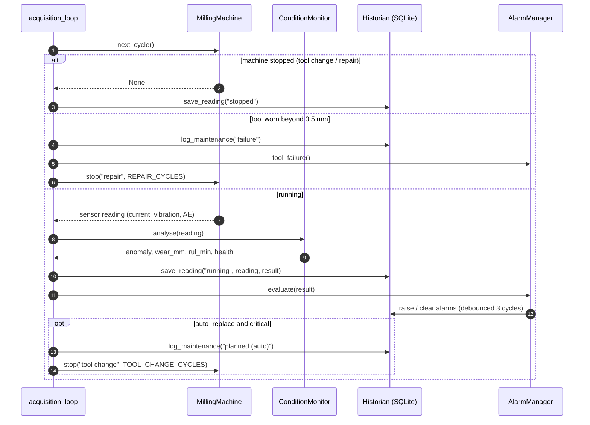
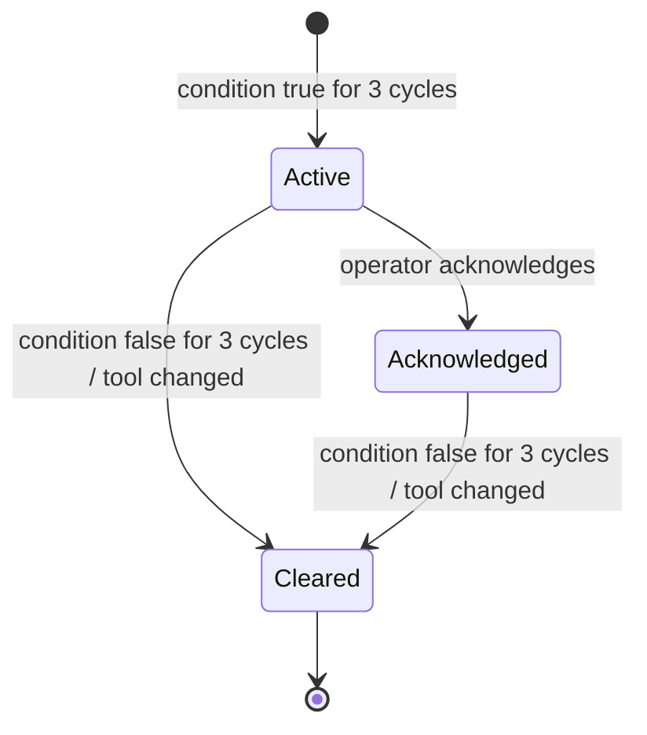

# Predictive Maintenance – CNC Milling Machine

Predict **when** the cutting tool of a CNC milling machine will be worn out, and plan the
tool change before it fails. Built on real run-to-failure data (NASA Milling dataset).

## Architecture

The diagrams below are written in [Mermaid](https://mermaid.js.org/) and render directly on GitHub / GitLab.

### System overview

### One acquisition cycle

### Alarm life cycle

## Limits of this demo (vs. a real plant)

- The simulator replays the same 13 tools the models were trained on, so live predictions look a bit
  better than the notebook scores. The notebook scores are the honest numbers.
- 16 tools is a small dataset: real projects collect hundreds of tool lives.
- A real plant reads the sensors from the PLC (OPC UA / MQTT), stores them in a real historian,
  and sends work orders to a maintenance system (CMMS). Here everything is in one process.
# PredMaint
